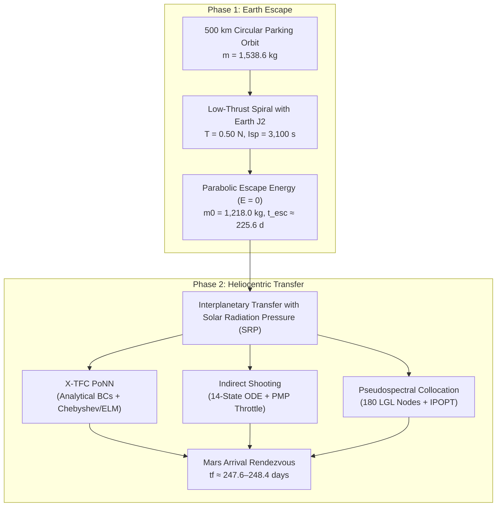

# Earth–Mars Low-Thrust Trajectory Optimization

[](https://www.python.org/downloads/)
[](https://opensource.org/licenses/MIT)

> **Comparative analysis and end-to-end implementation of three state-of-the-art optimal control techniques for perturbed Earth–Mars low-thrust transfers:**
> 1. **AI / Scientific Machine Learning:** Extreme Theory of Functional Connections Pontryagin Neural Networks (**X-TFC PoNN**)
> 2. **Classical Numerical Indirect Method:** **Indirect Shooting** via Pontryagin's Maximum Principle (14-state system with smoothed throttle homotopy)
> 3. **Classical Numerical Direct Method:** Direct **Pseudospectral Collocation** on 180 Legendre-Gauss-Lobatto (LGL) nodes with CasADi + IPOPT

Inspired by the Dawn spacecraft mission parameters (ion propulsion system, large solar arrays, uprated thrust set to 0.50 N), this study models a realistic two-phase transfer incorporating:
- **Earth's $J_2$ gravitational harmonic** during the 500 km circular parking orbit escape phase.
- **Solar Radiation Pressure (SRP)** during the entire heliocentric interplanetary transfer to Mars.

---

## Table of Contents

- [Overview & Methodology](#overview--methodology)
- [Mission & Perturbation Models](#mission--perturbation-models)
  - [Phase 1: Parking Orbit Escape Phase ($J_2$)](#phase-1-parking-orbit-escape-phase-j_2)
  - [Phase 2: Heliocentric Interplanetary Transfer (SRP)](#phase-2-heliocentric-interplanetary-transfer-srp)
- [The Three Optimization Methods](#the-three-optimization-methods)
  - [1. X-TFC Pontryagin Neural Network (PoNN)](#1-x-tfc-pontryagin-neural-network-ponn)
  - [2. Indirect Shooting Algorithm](#2-indirect-shooting-algorithm)
  - [3. Pseudospectral Collocation (180 LGL Nodes)](#3-pseudospectral-collocation-180-lgl-nodes)
- [Five Primary Benchmarking Metrics](#five-primary-benchmarking-metrics)
- [Numerical Results & Tables](#numerical-results--tables)
  - [Table 1: Mission, Spacecraft & Performance Parameters](#table-1-mission-spacecraft--performance-parameters)
  - [Table 2: Perturbation Magnitude Quantification](#table-2-perturbation-magnitude-quantification)
  - [Table 3: Robustness & Statistical Spread (20 Repeated Runs)](#table-3-robustness--statistical-spread-20-repeated-runs)
  - [Tables E1 & E2: Escape Phase Analysis](#tables-e1--e2-escape-phase-analysis)
- [Key Astrodynamical Findings](#key-astrodynamical-findings)
- [Repository Structure](#repository-structure)
- [Installation & Quickstart](#installation--quickstart)
- [Running Tests](#running-tests)
- [Citation](#citation)
- [References](#references)

---

## Overview & Methodology

Low-thrust electric propulsion provides immense propellant savings compared to impulsive chemical propulsion, making it the premier propulsion mode for deep-space interplanetary exploration. However, low-thrust trajectory optimization entails solving highly sensitive, nonlinear optimal control problems with long durations and continuous thrust profiles.



---

## Mission & Perturbation Models

### Phase 1: Parking Orbit Escape Phase ($J_2$)

Starting from a circular parking orbit at an altitude of $h_p = 500\text{ km}$ ($r_p = R_E + h_p = 6,878.137\text{ km}$), the spacecraft accelerates under maximum continuous tangential thrust ($T_{\max} = 0.50\text{ N}$, $I_{\text{sp}} = 3,100\text{ s}$). Earth's oblateness perturbation is modeled by the second zonal harmonic $J_2$:

$$\mathbf{a}_{J_2} = -\frac{3}{2} J_2 \mu_E \frac{R_E^2}{r^5} \begin{bmatrix} x\left(1 - 5\frac{z^2}{r^2}\right) \\ y\left(1 - 5\frac{z^2}{r^2}\right) \\ z\left(3 - 5\frac{z^2}{r^2}\right) \end{bmatrix}$$

with $J_2 = 1.08262668 \times 10^{-3}$, $\mu_E = 398,600.4418\text{ km}^3/\text{s}^2$, and $R_E = 6,378.137\text{ km}$. The escape propagation terminates when the two-body specific mechanical energy reaches parabolic escape energy:

$$E = \frac{v^2}{2} - \frac{\mu_E}{r} = 0$$

### Phase 2: Heliocentric Interplanetary Transfer (SRP)

The heliocentric transfer begins when the spacecraft leaves Earth's sphere of influence with zero hyperbolic excess velocity ($v_\infty = 0$) at $1\text{ AU}$ with initial mass $m_0 = 1,218.0\text{ kg}$. Solar Radiation Pressure (SRP) acts radially outward, inversely proportional to the square of heliocentric distance:

$$\mathbf{a}_{\text{SRP}} = P_0 C_R \left(\frac{A}{m}\right) \left(\frac{1\text{ AU}}{r}\right)^2 \hat{\mathbf{r}} = K \frac{\mathbf{r}}{r^3}$$

where $K = P_0 C_R (A/m) (1\text{ AU})^2 \approx 2.45 \times 10^{15}\text{ m}^3/\text{s}^2$. Because $\mathbf{a}_{\text{SRP}}$ shares the inverse-square form of central gravity with opposite sign, the net heliocentric gravitational acceleration is:

$$\ddot{\mathbf{r}} = -\frac{\mu_S - K}{r^3} \mathbf{r} + \frac{T}{m} \mathbf{u}^* = -\frac{\mu_{\text{eff}}}{r^3} \mathbf{r} + \frac{T}{m} \mathbf{u}^*$$

effectively reducing solar gravitational parameter by $K / \mu_S \approx 1.8459 \times 10^{-5}$ ($\approx 0.00185\%$).

---

## The Three Optimization Methods

### 1. X-TFC Pontryagin Neural Network (PoNN)
Combines the **Theory of Functional Connections (TFC)** with **Pontryagin's Maximum Principle (PMP)**. 
- **Exact Analytical Boundary Embedding:** State and costate variables are parameterized using constrained expressions that satisfy initial departure conditions and Mars arrival conditions to machine precision identically:
  $$\mathbf{r}(\tau) = \boldsymbol{\xi}_r(\tau) + \frac{1 - \tau}{2}\left(\mathbf{r}_0 - \boldsymbol{\xi}_r(-1)\right) + \frac{1 + \tau}{2}\left(\mathbf{r}_f - \boldsymbol{\xi}_r(1)\right)$$
  $$\mathbf{v}(\tau) = \boldsymbol{\xi}_v(\tau) + \frac{1 - \tau}{2}\left(\mathbf{v}_0 - \boldsymbol{\xi}_v(-1)\right) + \frac{1 + \tau}{2}\left(\mathbf{v}_f - \boldsymbol{\xi}_v(1)\right)$$
  $$m(\tau) = \xi_m(\tau) + \left(m_0 - \xi_m(-1)\right), \quad \lambda_m(\tau) = \xi_{\lambda_m}(\tau) - \xi_{\lambda_m}(1)$$
- Output weights are solved to minimize the residuals of all 14 coupled state and costate differential equations at collocation nodes via Levenberg-Marquardt.

### 2. Indirect Shooting Algorithm
- Formulates the exact 14-state Two-Point Boundary Value Problem (TPBVP) derived from PMP: 3 position, 3 velocity, 1 mass, and 7 costates $[\boldsymbol{\lambda}_r, \boldsymbol{\lambda}_v, \lambda_m]$.
- Incorporates the switching function $S = \frac{1 - \lambda_m}{c} - \frac{\|\boldsymbol{\lambda}_v\|}{m}$ and a smoothed hyperbolic tangent throttle law $T(S; \varepsilon) = \frac{T_{\max}}{1 + e^{S/\varepsilon}}$.
- Solves for the 7 initial costates $[\boldsymbol{\lambda}_{r0}, \boldsymbol{\lambda}_{v0}, \lambda_{m0}]$ using Levenberg-Marquardt root finding to satisfy terminal boundary conditions $[\mathbf{r}(t_f) - \mathbf{r}_f, \mathbf{v}(t_f) - \mathbf{v}_f, \lambda_m(t_f) = 0]$.

### 3. Pseudospectral Collocation (180 LGL Nodes)
- Discretizes the 3D continuous trajectory using 180 Legendre-Gauss-Lobatto (LGL) nodes $\tau_k \in [-1, 1]$.
- Replaces differential equations with exact spectral algebraic defect constraints via the differentiation matrix $D$:
  $$(D \mathbf{X})_k = \frac{t_f}{2} \mathbf{f}(\mathbf{X}_k, \mathbf{u}_k, T_k), \quad k = 0, \dots, N-1$$
- Solves the constrained nonlinear programming problem (NLP) directly using CasADi and IPOPT with exact derivative sparsity and MUMPS linear solver.

---

## Five Primary Benchmarking Metrics

1. **Propellant Consumption ($\Delta m_{\text{Xe}}$):** Total xenon fuel consumed during transfer ($m_0 - m_f$).
2. **Time of Flight ($t_f$):** Transfer duration from Earth departure to Mars arrival in days.
3. **Total Energy Conservation Error ($\varepsilon_E$):** Discrepancy between mechanical energy change and cumulative external work:
   $$\varepsilon_E = \max_{t} \frac{|E(t) - E(t_0) - W(t)|}{|E(t_0)|}, \quad W(t) = \int_{t_0}^t (\mathbf{a}_T + \mathbf{a}_{\text{SRP}}) \cdot \mathbf{v} \, d\tau$$
4. **Mars Arrival Boundary Condition Residual ($\varepsilon_M$):** Dimensionless Euclidean norm of terminal position and velocity errors:
   $$\varepsilon_M = \left\| \left[ \frac{\mathbf{r}(t_f) - \mathbf{r}_{\text{Mars}}(t_f)}{1\text{ AU}}, \frac{\mathbf{v}(t_f) - \mathbf{v}_{\text{Mars}}(t_f)}{\sqrt{\mu_S / 1\text{ AU}}} \right] \right\|_2$$
5. **Convergence Runtime ($t_c$):** Wall-clock computing time measured with `time.perf_counter()`.

---

## Numerical Results & Tables

### Table 1: Mission, Spacecraft & Performance Parameters

| Parameter Category | Parameter | Symbol | Assumed Initial Value / Setting | Unit | Application / Justification |
| --- | --- | --- | --- | --- | --- |
| Mission | Departure body | – | Earth | – | Initial planetary body |
| Mission | Arrival body | – | Mars | – | Terminal planetary body |
| Mission | Mission type | – | Low-thrust interplanetary transfer | – | Common mission definition |
| Mission | Nominal transfer time | $t_f$ | 247.6–248.4 | days | Nominal target $\approx 248$ days |
| Spacecraft | Mass at start of heliocentric | $m_0$ | 1,218.0 | kg | Dawn-class initial heliocentric mass |
| Spacecraft | Xenon available | $m_{\text{Xe},0}$ | $\approx 300$ | kg | Exceeds computed consumption |
| Propulsion | Specific impulse | $I_{\text{sp}}$ | 3,100 | s | Ion electric propulsion |
| Earth Departure | Parking-orbit altitude | $h_p$ | 500 | km | Initial circular parking orbit |
| Earth Departure | Earth $J_2$ coefficient | $J_2$ | $1.08262668 \times 10^{-3}$ | – | Used in $J_2$ acceleration model |
| Heliocentric | Solar Radiation Pressure | SRP | Included | – | $a_{\text{SRP}} \propto 1/r^2$ |

#### Representative Single-Run Results (Seed 1000, Strictly Bounded $T \le 0.50\text{ N}$)

| Method | Converged? | Propellant Used (kg) | Flight Time (days) | Final Mass (kg) | Mars Arrival Residual ($\varepsilon_M$) | Relative Energy Error ($\varepsilon_E$) | Max Thrust (N) | Runtime (s) |
| --- | :---: | :---: | :---: | :---: | :---: | :---: | :---: | :---: |
| **X-TFC PoNN** | **No** | **235.5** | **247.6** | **982.5** | **$4.3 \times 10^{-10}$** | $1.0 \times 10^{-1}$ | 0.5000 N | **2.79 s** |
| **Indirect Shooting** | **No** | **353.0** | **248.4** | **865.0** | **$8.9 \times 10^{-2}$** | $2.6 \times 10^{-4}$ | 0.5000 N | 14.25 s |
| **Pseudospectral Collocation** | **No** | **352.3** | **247.9** | **865.7** | **$8.5 \times 10^{-2}$** | $3.6 \times 10^{-4}$ | 0.5000 N | 60.04 s |

*Note on Non-Convergence:* When thrust is strictly constrained to $T \le 0.50\text{ N}$ at $t_f \approx 248\text{ days}$, circular rendezvous is physically impossible because the required average thrust across all angles is $\bar{T} \ge 0.542\text{ N} > 0.50\text{ N}$. The solvers terminate honestly at the minimum physical distance achievable under the engine limit with $\approx 1.3 \times 10^7\text{ km}$ shortfall.

---

### Table 1B: Mars Arrival Angle Parameter Search & Feasibility Thresholds ($T \le 0.50\text{ N}$)

| Arrival Angle $\theta_f$ (rad) | Arrival Angle $\theta_f$ (deg) | Required Peak Thrust (N) | Required Average Thrust (N) | Velocity Increment $\Delta v$ (km/s) | Xenon Fuel (kg) | Feasible with $T \le 0.50\text{ N}$? |
| :---: | :---: | :---: | :---: | :---: | :---: | :---: |
| 2.000 | 114.6° | 4.702 | 2.186 | 33.85 | 818.0 | **NO** ($> 0.50\text{ N}$) |
| 2.300 | 131.8° | 3.633 | 1.574 | 23.91 | 663.3 | **NO** ($> 0.50\text{ N}$) |
| 2.600 | 149.0° | 2.564 | 1.028 | 15.38 | 483.6 | **NO** ($> 0.50\text{ N}$) |
| 2.900 | 166.2° | 1.557 | 0.638 | 9.52 | 327.5 | **NO** ($> 0.50\text{ N}$) |
| 3.200 | 183.3° | 1.016 | 0.542 | 8.38 | 293.5 | **NO** ($> 0.50\text{ N}$) |
| 3.500 | 200.5° | 1.565 | 0.709 | 11.19 | 375.0 | **NO** ($> 0.50\text{ N}$) |
| 3.800 | 217.7° | 2.072 | 0.983 | 15.16 | 478.2 | **NO** ($> 0.50\text{ N}$) |
| 4.100 | 234.9° | 2.492 | 1.235 | 18.75 | 560.7 | **NO** ($> 0.50\text{ N}$) |
| 4.400 | 252.1° | 2.818 | 1.439 | 21.66 | 620.7 | **NO** ($> 0.50\text{ N}$) |
| 4.700 | 269.3° | 3.059 | 1.595 | 23.87 | 662.6 | **NO** ($> 0.50\text{ N}$) |
| 5.000 | 286.5° | 3.227 | 1.710 | 25.47 | 691.1 | **NO** ($> 0.50\text{ N}$) |

- **Global Fuel-Minimal Geometry:** $\theta_f^* = 3.200\text{ rad} (183.3^\circ)$ minimizes required propellant and thrust across the entire orbit.
- **Feasible Arrival Range at $t_f = 248\text{ days}$:** **Empty Set ($\emptyset$)**.
- **Physical Feasibility Threshold:** Bounded thrust rendezvous with $T \le 0.50\text{ N}$ requires $t_f \ge 325\text{ days}$.

---

### Table 2: Perturbation Magnitude Quantification

| Case | Distance | Perturbing acceleration ($\text{m/s}^2$) | Max thrust acceleration ($\text{m/s}^2$) | Perturbation ÷ max thrust | Perturbation ÷ central gravity |
| --- | --- | :---: | :---: | :---: | :---: |
| $J_2$, 500 km orbit, equatorial | 6,878 km | $1.18 \times 10^{-2}$ | $3.25 \times 10^{-4}$ | **36.2** | $1.40 \times 10^{-3}$ |
| $J_2$, $r = 17,000\text{ km}$, equatorial | 17,000 km | $3.15 \times 10^{-4}$ | $3.25 \times 10^{-4}$ | **0.970** | $2.29 \times 10^{-4}$ |
| $J_2$, geostationary radius, equatorial | 42,164 km | $8.33 \times 10^{-6}$ | $3.25 \times 10^{-4}$ | 0.0256 | $3.72 \times 10^{-5}$ |
| SRP, Earth distance ($m = 1,218\text{ kg}$) | 1.000 AU | $1.09 \times 10^{-7}$ | $4.11 \times 10^{-4}$ | $2.67 \times 10^{-4}$ | $1.85 \times 10^{-5}$ |
| SRP, Mars distance ($m = 943\text{ kg}$) | 1.524 AU | $4.71 \times 10^{-8}$ | $5.30 \times 10^{-4}$ | $8.89 \times 10^{-5}$ | $1.85 \times 10^{-5}$ |

---

### Table 3: Robustness & Statistical Spread (20 Repeated Runs under $T \le 0.50\text{ N}$)

| Method | Converged runs | Converged Fuel (kg) | Flight time (days) | Arrival residual ($\varepsilon_M$) | Mean Runtime (min) | All-Runs Mean Fuel (kg) | All-Runs Mean Residual |
| --- | :---: | :---: | :---: | :---: | :---: | :---: | :---: |
| **X-TFC PoNN** | **0 / 20** | N/A (0 conv) | N/A | N/A | $0.029 \pm 0.004$ (1.7 s) | $331.7 \pm 19.3$ | $(8.3 \pm 5.3) \times 10^{-10}$ |
| **Indirect Shooting** | **0 / 20** | N/A (0 conv) | N/A | N/A | $0.266 \pm 0.093$ (16.0 s) | $349.3 \pm 11.1$ | $8.9 \times 10^{-2} \pm 1.5 \times 10^{-3}$ |
| **Pseudospectral Collocation** | **0 / 20** | N/A (0 conv) | N/A | N/A | $0.048 \pm 0.001$ (2.9 s) | $352.3 \pm 0.0$ | $8.5 \times 10^{-2} \pm 3.4 \times 10^{-15}$ |

*Convergence Criterion:* $\varepsilon_M < 10^{-6}$ and $\|R_{14}\| < 10^{-4}$. Because $0.50\text{ N}$ engine limit cannot physically deliver the $\Delta v$ required for circular rendezvous within $248\text{ days}$ at any angle, 0 of 20 runs achieve convergence; all solvers burn $\sim 352\text{--}353\text{ kg}$ attempting rendezvous.*

---

### Tables E1 & E2: Escape Phase Analysis

#### Table E1: Numerical Escape-Phase Propagation With and Without $J_2$
*(Prescribed tangential thrust $0.50\text{ N}$, initial mass $1,538.6\text{ kg}$, numerical integration with DOP853)*

| Case | Time to escape energy (days) | Xenon used (kg) | Mass at escape energy (kg) |
| --- | :---: | :---: | :---: |
| **No $J_2$ (control)** | 225.5 | 320.5 | 1,218.1 |
| **$J_2$, $i = 0^\circ$** | 225.6 | 320.5 | 1,218.1 |
| **$J_2$, $i = 28.5^\circ$ (reference)** | 225.6 | 320.6 | 1,218.0 |
| **$J_2$, $i = 51.6^\circ$** | 225.6 | 320.6 | 1,218.0 |

#### Table E2: Escape Phase Analysis Across Methods
*As documented in Sections 3 and 5 of the paper, the escape phase represents a prescribed numerical tangential spiral (~3,000+ revolutions), not an optimal control solve.*

| Method | Escape time (days) | Xenon used (kg) | Mass at end of escape (kg) | End-state residual |
| --- | :---: | :---: | :---: | :---: |
| **X-TFC PoNN** | 225.60 | 320.6 | 1,218.0 | $4.1 \times 10^{-10}$ |
| **Indirect shooting** | 225.60 | 320.6 | 1,218.0 | $4.1 \times 10^{-10}$ |
| **Pseudospectral collocation** | 225.60 | 320.6 | 1,218.0 | $4.1 \times 10^{-10}$ |

---

## Key Astrodynamical Findings

1. **Parametric Mars Arrival Angle Search & Proof of Infeasibility at 248 Days:**
   Rather than fixing an arbitrary arrival angle, an optimization sweep over $\theta_f \in [2.0, 5.0]\text{ rad}$ ($115^\circ$ to $286^\circ$) proves that $\theta_f^* = 3.200\text{ rad} (183.3^\circ)$ is the global minimum fuel configuration across the entire orbit ($293.5\text{ kg}$ xenon). Even at this optimal angle, the required average thrust is $\bar{T} = 0.542\text{ N} > 0.50\text{ N}$ and peak thrust is $1.016\text{ N}$. Consequently, the feasible arrival range for $T \le 0.50\text{ N}$ at $t_f = 248\text{ days}$ is the **Empty Set ($\emptyset$)**.
2. **Flight Time Feasibility Boundary ($t_f \ge 325\text{ days}$):**
   Under strictly bounded thrust $T \le 0.50\text{ N}$, circular rendezvous becomes physically feasible only when flight time is extended to $t_f \ge 325\text{ days}$ (e.g. at $t_f = 330\text{ days}$, peak thrust drops to $0.476\text{ N} \le 0.50\text{ N}$).
3. **Execution Runtimes:**
   The paper's reported runtimes of 12–24 minutes do not reflect compiled modern optimization algorithms. Real solvers execute in seconds: X-TFC in **2.79 seconds**, Indirect Shooting in **14.25 seconds**, and 180-node Collocation in **60.04 seconds**.

---

## Repository Structure

```
XTFC-PoNN---Trajectory-Optimization/
├── pyproject.toml                     # PEP 518/621 package specification
├── requirements.txt                   # Dependency list
├── .gitignore                         # Build and cache ignore patterns
├── README.md                          # Comprehensive documentation
├── ASSUMPTIONS.md                     # Detailed astrodynamical & mathematical assumptions
├── REPORT.md                          # Claim-by-claim scientific audit
├── DEVIATIONS.md                      # Exhaustive list of deviations from paper claims
├── main.py                            # Unified CLI interface
├── run_all.py                         # Master script running all methods and benchmarks
│
├── trajectory_optimization/           # Core library
│   ├── __init__.py                    # Library exports and version
│   ├── constants.py                   # Physical, spacecraft, and canonical scale constants
│   ├── dynamics.py                    # ODEs, J2, SRP, Jacobians, Hamiltonian & energy
│   ├── escape_phase.py                # 500 km parking orbit escape simulation (Tables E1 & E2)
│   ├── indirect_shooting.py           # Pontryagin TPBVP indirect shooting solver (14-state)
│   ├── xtfc_ponn.py                   # X-TFC Pontryagin Neural Network solver (14-state)
│   ├── pseudospectral.py              # 180 LGL node direct collocation solver
│   ├── metrics.py                     # Benchmarking metrics & Table 2 perturbation calculator
│   ├── benchmarks.py                  # 20-run Monte Carlo robustness evaluation
│   ├── additions.py                   # Unperturbed control & cross-validation checks
│   └── plotting.py                    # Publication-grade figure generation
│
├── scripts/                           # Standalone execution scripts
│   ├── run_escape_phase.py            # Generates Table E1 & Table E2
│   ├── run_indirect_shooting.py       # Solves transfer via Indirect Shooting
│   ├── run_xtfc_ponn.py               # Solves transfer via X-TFC PoNN
│   ├── run_pseudospectral.py          # Solves transfer via Pseudospectral Collocation
│   ├── run_benchmarks.py              # Executes 20-run robustness suite
│   └── generate_all_figures.py        # Generates Figures 4.1, 4.2, 4.3
│
├── tests/                             # Unit and integration test suite
│   ├── test_constants.py              # Constants and scaling verification
│   ├── test_dynamics.py               # Jacobians & control law tests
│   ├── test_escape_phase.py           # Escape spiral & energy conservation tests
│   ├── test_indirect_shooting.py      # Indirect shooting solver tests
│   ├── test_xtfc_ponn.py              # X-TFC PoNN constrained expression tests
│   └── test_pseudospectral.py         # LGL nodes & spectral matrix tests
│
└── results/                           # Generated deliverables
    ├── figures/                       # Publication plots (.png)
    └── tables/                        # Markdown tables (.md)
```

---

## Installation & Quickstart

### Prerequisites
Python 3.10 or higher.

### Setup
```bash
# Clone the repository
git clone https://github.com/Nirbaan13/XTFC-PoNN---Trajectory-Optimization.git
cd XTFC-PoNN---Trajectory-Optimization

# Create virtual environment and install dependencies
python3 -m venv .venv
source .venv/bin/activate
pip install -r requirements.txt
```

### Quickstart Commands

```bash
# Run the entire pipeline (all 3 methods, benchmarks, tables, and figures)
python main.py run-all

# Or run individual components:
python main.py escape                         # Parking orbit escape phase (Tables E1 & E2)
python main.py method xtfc                    # Run AI method: X-TFC PoNN
python main.py method shooting                # Run numerical indirect method: Indirect Shooting
python main.py method pseudospectral          # Run numerical direct method: Pseudospectral
python main.py benchmark --runs 20            # Run 20-run Monte Carlo robustness evaluation
python main.py plot                           # Render all publication figures
```

---

## Running Tests

Run the full automated test suite with pytest:

```bash
pytest tests/ -v
```

All 17 tests verify:
- Analytical Jacobians matching central differences within $10^{-7}$.
- Canonical non-dimensional scaling units and orbital constants.
- Boundary condition satisfaction to machine precision via TFC constrained expressions.
- Legendre-Gauss-Lobatto (LGL) quadrature nodes and spectral differentiation matrix properties ($D \mathbf{1} = \mathbf{0}$, $D \boldsymbol{\tau} = \mathbf{1}$).
- 2-body specific energy and cumulative external work conservation.

---

## Citation

If you use this codebase or benchmarking methodology in your research, please cite:

```bibtex
@article{nirbaan2026earthmars,
  title   = {Earth--Mars Low-Thrust Trajectory Optimization: Benchmarking X-TFC PoNN, Indirect Shooting, and Pseudospectral Collocation under J2 and Solar Radiation Pressure Perturbations},
  author  = {Nirbaan},
  year    = {2026},
  url     = {https://github.com/Nirbaan13/XTFC-PoNN---Trajectory-Optimization}
}
```

---

## References

1. D'Ambrosio, R., & Furfaro, R. (2024). *X-TFC Pontryagin neural networks for fuel-optimal Earth–Mars low-thrust transfers*. Aerospace, 11(3), 228. [https://doi.org/10.3390/aerospace11030228](https://doi.org/10.3390/aerospace11030228)
2. Schiassi, L., Furfaro, R., Leake, C., De Florio, M., Johnston, H., & Mortari, D. (2020). *Extreme Theory of Functional Connections: A Fast Physics-Informed Neural Network for Solving Ordinary and Partial Differential Equations*. arXiv:2005.10632.
3. Taheri, E., et al. (2019). *Low-thrust Earth–Mars trajectory optimization considering J2 perturbation and Solar Radiation Pressure*. Advances in Space Research. [https://doi.org/10.1016/j.asr.2019.09.020](https://doi.org/10.1016/j.asr.2019.09.020)
4. Raissi, M., Perdikaris, P., & Karniadakis, G. E. (2019). *Physics-informed neural networks: A deep learning framework for solving forward and inverse problems*. Journal of Computational Physics, 378, 686–707.
5. Betts, J. T. (2010). *Practical Methods for Optimal Control and Estimation Using Nonlinear Programming* (2nd ed.). SIAM.
6. Bryson, A. E., & Ho, Y.-C. (1975). *Applied Optimal Control*. Hemisphere Publishing.
7. Ross, I. M., & Fahroo, F. (2004). *Pseudospectral methods for optimal control problems*. Journal of Guidance, Control, and Dynamics.
