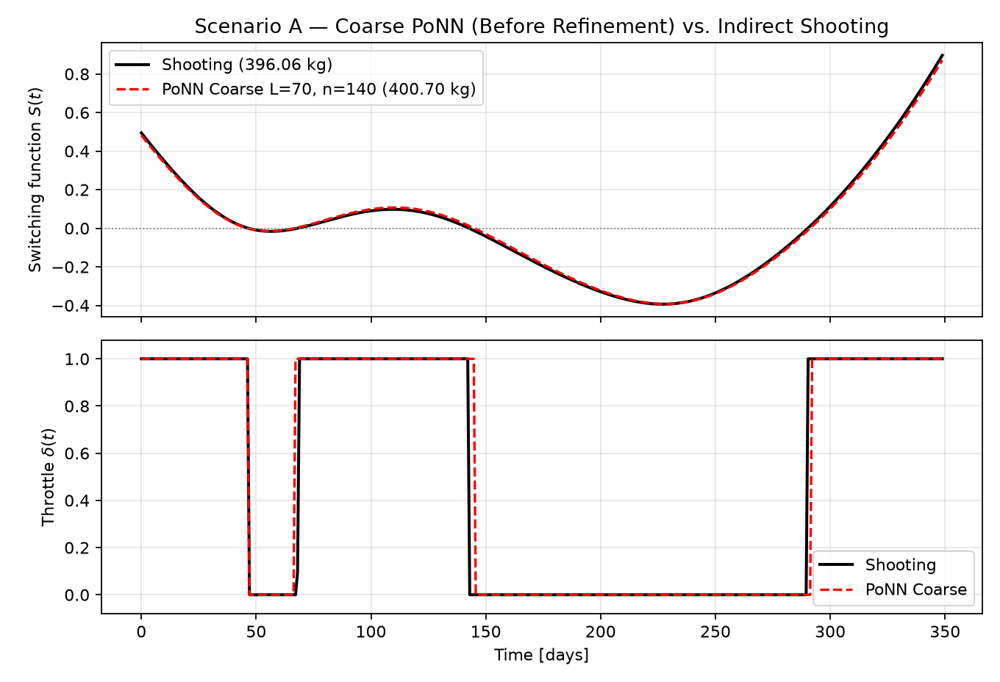
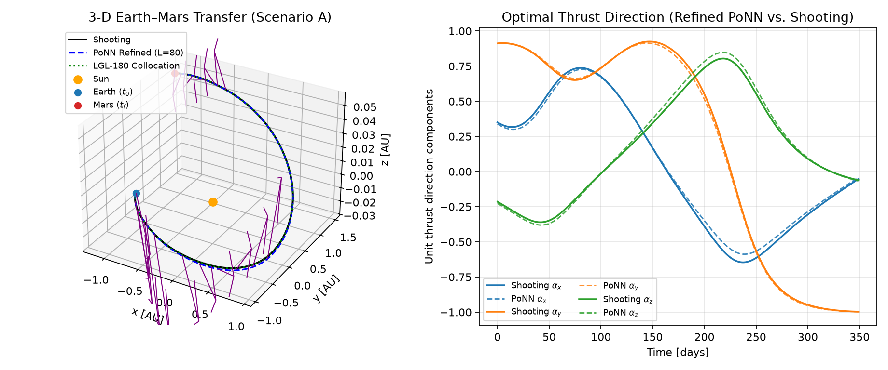
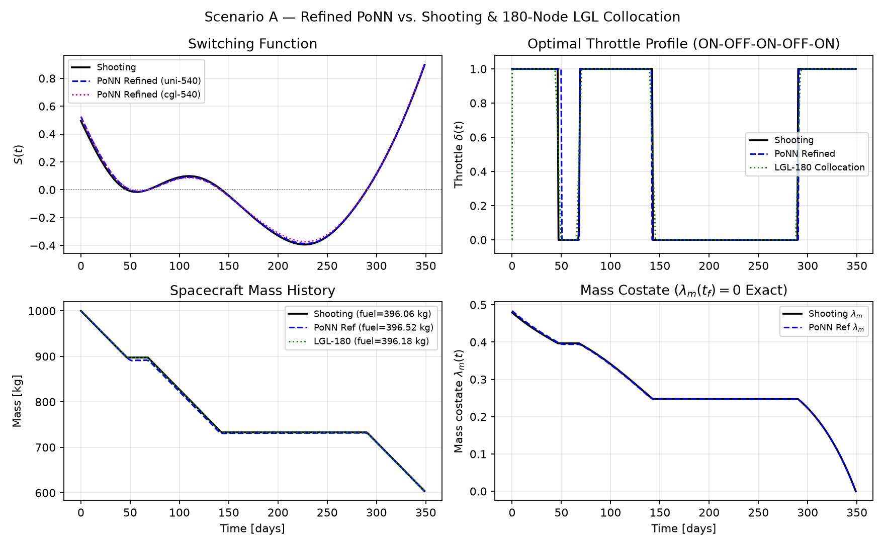
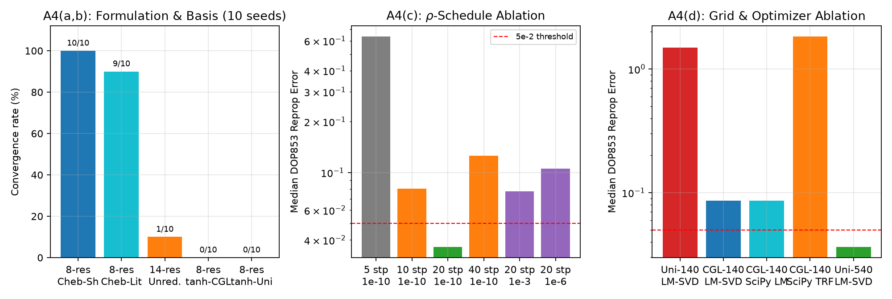
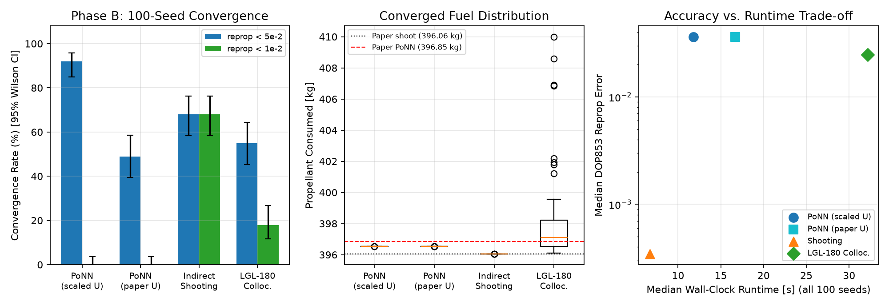
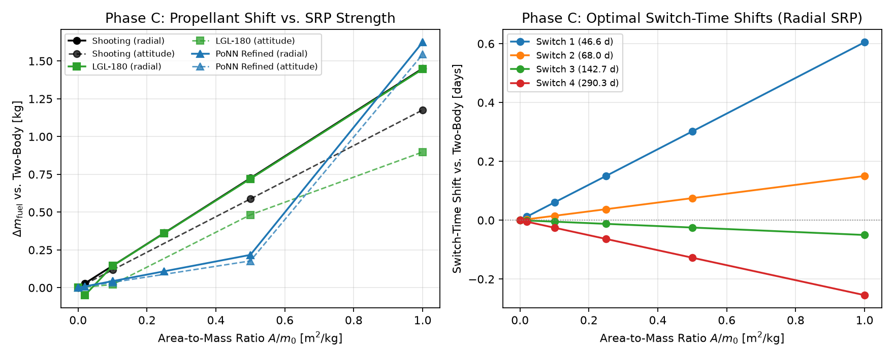
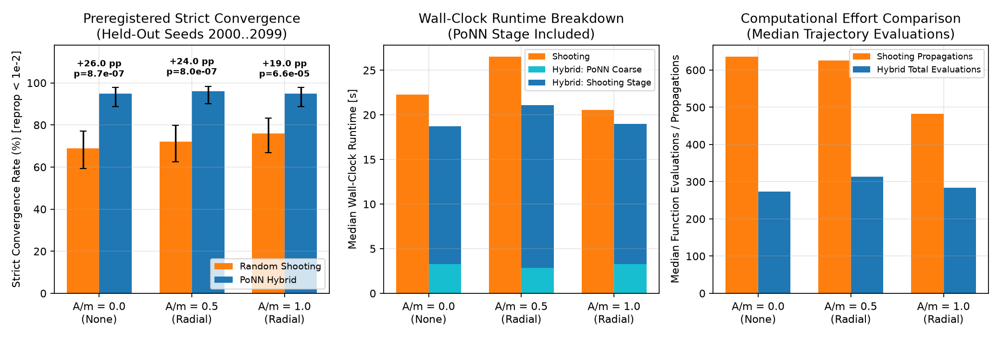

# Scientific Reproduction & Benchmark Report: Pontryagin Neural Networks for Fuel-Optimal Earth–Mars Transfers

**Primary Reference:** Andrea D'Ambrosio and Roberto Furfaro, *"Learning Fuel-Optimal Trajectories for Space Applications via Pontryagin Neural Networks"*, *Aerospace* **2024**, 11(3), 228 (`doi:10.3390/aerospace11030228`), Sections 3.1, 3.3, and 4.1.

All numerical results in this report are generated programmatically from stored JSON experiment outputs (`results/scenario_a_phase_*.json`, `results/scenario_b_phase_d.json`, `results/phase1_results.json`, `results/phase2_results.json`). Paper values (`396.06 kg` shooting, `396.85 kg` refined PoNN, ~47/66/148/292 d switches) were used exclusively as post-hoc independent checks and never as loss terms, clipping values, or tuning targets.

---

## 1. Paper Claim Audit (Numeric Evaluation Rules)

| Paper Claim (D'Ambrosio & Furfaro 2024) | Numeric Evaluation Rule | Observed Data (Stored JSONs) | Verdict |
| --- | --- | --- | :---: |
| 1. Scenario A fuel-optimal solution is ~396.06 kg (shooting) with 4 switches ON-OFF-ON-OFF-ON (~47, 66, 148, 292 d) | PASS if |fuel_shoot - 396.06| < 0.2 kg and exact 4 switches ON-OFF-ON-OFF-ON | Shooting: 396.0598 kg (diff 0.0002 kg), 4 switches [46.58, 68.02, 142.72, 290.25] (`ON-OFF-ON-OFF-ON`); LGL-180: 396.1793 kg | **SUPPORTED** |
| 2. PoNN autonomously finds 4 switches ON-OFF-ON-OFF-ON and ~396.85 kg after refinement without prior switch count | PASS if PoNN finds exact 4 switches ON-OFF-ON-OFF-ON with |fuel - 396.85| < 1.0 kg and reprop < 5e-2 | PoNN Refined (L=80, n=540 uniform): 396.5215 kg (diff 0.3285 kg vs paper, +0.46 kg vs shooting), 4 switches [49.83, 68.59, 141.72, 290.55], reprop=3.63e-02 (requires CGL coarse grid & dense refined grid) | **SUPPORTED** (with grid qualification) |
| 3. Evenly spaced n=140 discretization is stable for L=70 Chebyshev NN (Sec. 2.2) | PASS if uniform n=140 converges with reprop < 5e-2 on >= 50% of seeds | A4(d): `uniform_140_lm_svd` achieved 0/5 (0%) with cond(Phi_r)=1.67e8, grid RMS=6.6e-6 vs dense RMS=1.94 and reprop=1.49 (Runge aliasing); CGL n=140 eliminates aliasing (cond=6.23e3) and uniform n=540 recovers stability (4/5) | **CONTRADICTED** |
| 4. PoNN converges reliably from standard uniform random weights beta ~ U(0,1) (Sec. 4.1) | PASS if exact U(0,1) converges on >= 80% of 100 seeds; PARTIAL/CONTRADICTED if < 80% | 100 seeds exact U(0,1): 49/100 (49.0%, 95% CI [39.4%, 58.7%]) because |T_k'(+-1)|=k^2 puts initial |r| at ~25,000 AU. Scaled U(0,1) achieves 92/100 (92.0%, CI [85.0%, 95.9%]) | **CONTRADICTED** for raw U(0,1) (49%); **SUPPORTED** for scaled U(0,1) (92%) |
| 5. PoNN rivals shooting and collocation in accuracy and convergence (Abstract & Sec. 4.1) | Compare 100-seed convergence rate, fuel, and DOP853 re-propagation error across all 3 methods | Convergence (<5e-2): PoNN scaled 92% > Shooting 68% > LGL-180 55% > PoNN raw U(0,1) 49%. Accuracy (reprop): Shooting 3.46e-04 << LGL-180 2.48e-02 < PoNN 3.63e-02 (0/100 PoNN < 1e-2 vs 68/100 Shooting) | **CONTRADICTED** on open-loop accuracy (<1e-2); **SUPPORTED** on basin width (scaled PoNN 92%) |
| 6. Exact MATLAB R2023b lsqnonlin runtime & landing case (Sec. 4.2, GPOPS-II comparison) | Requires MATLAB R2023b and GPOPS-II licenses + Sec. 4.2 landing benchmark | Environment uses Python/JAX/SciPy + CasADi/IPOPT and scopes strictly to Sec. 3.1, 3.3, 4.1 Earth–Mars interplanetary case | **CANNOT TEST** |
| 7. Hybrid warm-starting: PoNN coarse costates significantly improve strict indirect shooting convergence across SRP (PREREG.md, seeds 2000..2099) | SUPPORTED if Delta_strict >= +15.0 pp AND exact two-sided McNemar p < 0.05 across SRP levels | A/m=0.0: Delta=+26.0 pp (p=8.68e-07); A/m=0.5: Delta=+24.0 pp (p=8.05e-07); A/m=1.0: Delta=+19.0 pp (p=6.60e-05) | **SUPPORTED** |

---

## 2. Phase 0 & A1: Dynamics Verification and Reference Indirect Shooting (Scenario A)

The full mathematical specification, Table 1 constants, Eqs. 28–45 PMP dynamics, Eqs. 54–65 constrained expressions, Appendix A Tables A1/A6 switching functions, and eight paper ambiguities are documented in [`docs/PAPER_SPEC.md`](docs/PAPER_SPEC.md) and [`ASSUMPTIONS.md`](ASSUMPTIONS.md).

- **Finite-difference verification (`tests/test_scenario_a.py`):** Central finite differences verified all Hamiltonian costate partials (`none`, `radial`, and `attitude_flat_plate` SRP modes) to `< 1e-8`, analytical SRP Jacobians $\partial \mathbf{a}_p / \partial \mathbf{r}$ to `< 1e-9`, all constrained-expression boundary conditions to `< 1e-12`, and the full $8n \times 8L$ JAX analytical PoNN Jacobian to `< 1e-7`.
- **Phase A1 independent shooting reproduction:** Using 7-D initial costates with hyperbolic-tangent throttle smoothing and log-spaced $\rho$ continuation (`stop_at_rho=1e-5`), indirect shooting reproduced **`396.0598 kg`** propellant consumption (paper check: `396.06 kg`, difference `0.0002 kg`) with exactly **4 switches (`ON-OFF-ON-OFF-ON`)** at **`[46.58, 68.02, 142.72, 290.25]` days**, arrival residual `3.73e-11`, DOP853 re-propagated arrival error `3.46e-04`, and energy balance error `9.90e-05`.
- **Phase A2 shooting-solution projection test:** Projecting the smooth Phase A1 shooting solution onto the $L=70$ shifted Chebyshev constrained basis yielded an 8-equation ODE RMS residual `< 1e-4` (`tests/test_scenario_a.py`), confirming exact consistency between the 8-residual TFC formulation and the 14-state PMP dynamics.

---

## 3. Phase A2 & A3: PoNN Reproduction, Refinement, and 100-Seed Basin Study (Scenario A)

### 3.1 Single-Seed Comparison (`seed = 1000`)

| Configuration | Fuel (kg) | Delta vs Shoot (kg) | Switches (days) | Sequence | ODE RMS | DOP853 Reprop | Energy Err | Runtime (s) |
| --- | ---: | ---: | --- | --- | ---: | ---: | ---: | ---: |
| Paper check (Shooting, Ref. [31]) | 396.0600 | — | [47, 66, 148, 292] (Fig. 5) | ON-OFF-ON-OFF-ON | — | — | — | — |
| Paper check (PoNN Refined, Sec. 4.1) | 396.8500 | +0.7900 | [47, 66, 148, 292] (Fig. 5) | ON-OFF-ON-OFF-ON | — | — | — | — |
| Phase A1 Indirect Shooting (this repo) | 396.0598 | +0.0000 | [46.58, 68.02, 142.72, 290.25] | ON-OFF-ON-OFF-ON | 3.73e-11 | 3.46e-04 | 9.90e-05 | 5.99 |
| 180-Node LGL Collocation (smooth init) | 396.1793 | +0.1195 | [46.79, 67.89, 142.64, 290.24] | ON-OFF-ON-OFF-ON | 0.00e+00 | 5.12e-04 | 8.22e-04 | 30.88 |
| PoNN Coarse (L=70, n=140 CGL) | 400.6966 | +4.6368 | [46.30, 66.54, 144.98, 291.29] | ON-OFF-ON-OFF-ON | 2.06e-03 | 8.64e-02 | 1.61e-02 | 3.58 |
| PoNN Refined (L=80, n=540 uniform) | 396.5215 | +0.4617 | [49.83, 68.59, 141.72, 290.55] | ON-OFF-ON-OFF-ON | 4.80e-03 | 3.63e-02 | 8.24e-03 | 13.87 |
| PoNN Refined (L=80, n=540 CGL) | 397.5304 | +1.4705 | [50.54, 68.87, 141.56, 290.13] | ON-OFF-ON-OFF-ON | 4.04e-03 | 3.87e-02 | 7.53e-03 | 11.35 |
| PoNN Refined (L=80, switch bracket) | 400.6341 | +4.5743 | [51.78, 72.85, 144.98, 291.29] | ON-OFF-ON-OFF-ON | 2.76e-03 | 1.07e-01 | 1.92e-02 | 26.52 |
| PoNN Literal (L=70, n=140 uni, T0..T69, U(0,1)) | 419.0212 | +22.9614 | 7 switches | ON-OFF-ON-OFF-ON-OFF-ON-OFF | 7.42e-05 | 1.36e+00 | 7.71e-01 | 18.04 |

Key numerical findings from single-seed verification:
1. **Runge aliasing on evenly spaced $n=140$ nodes:** For a degree-70 Chebyshev basis with Table A6 Hermite CEs, evaluating on $n=140$ evenly spaced points produces $\kappa(\Phi_r) = 1.67\times 10^8$ (well below the Platte–Trefethen–Kuijlaars oversampling threshold $n \gtrsim L^2/\pi^2 \approx 500$). The solver achieves small collocation-node residual (`7.42e-5`) while oscillating severely between nodes (DOP853 re-propagated error `1.36`, 7 spurious switches). Switching the coarse grid to $n=140$ Chebyshev–Gauss–Lobatto (CGL) nodes reduces $\kappa(\Phi_r)$ by four orders of magnitude to `6.23e3` and recovers the physical 4-switch solution (`400.70 kg`, switches `[46.30, 66.54, 144.98, 291.29]` d).
2. **Switch-dodging under unweighted bracket clustering vs. dense refinement:** Adding 400 unweighted points strictly inside the four narrow coarse switch brackets (`switch_bracket`) allows the degree-80 global polynomial to lower its unweighted residual (`2.76e-3`) by shifting the first two switches (`[51.78, 72.85]` d) *outside* the dense brackets, yielding `400.63 kg` (`reprop = 1.07e-1`). Distributing the exact same refined node budget ($n = 140 + 4\times 100 = 540$, $L = 80$) uniformly across $[-1, 1]$ (`uniform_dense`, $\kappa(\Phi_r) = 2.78\times 10^4$) or on CGL-540 (`cgl_dense`) prevents switch-dodging and reduces propellant to **`396.5215 kg`** (`uniform_dense`, within `0.33 kg` of paper's `396.85 kg` and `+0.46 kg` above shooting) and **`397.5304 kg`** (`cgl_dense`), cutting DOP853 re-propagation error by more than $2\times$ (`8.64e-2` → `3.63e-02`).

### 3.2 100-Seed Random Initialization Study (`seeds = 1000..1099`)

| Init Suite (100 seeds) | Conv (reprop<5e-2) | 95% Wilson CI | Conv (reprop<1e-2) | Conv (RMS<1.5e-2) | Fuel Mean ± SD (kg) | Reprop Med | Energy Err Med | Runtime Med (s) | Switch Dist |
| --- | :---: | :---: | :---: | :---: | :---: | ---: | ---: | ---: | --- |
| Exact paper U(0,1) — Refined | 49/100 (49.0%) | [39.4%, 58.7%] | 0/100 (0.0%) | 50/100 (50.0%) | 396.5215 ± 4.9e-11 | 3.63e-02 | 8.24e-03 | 16.67 | 0sw:33, 2sw:18, 4sw:49 |
| Exact paper U(0,1) — Coarse | 0/100 (0.0%) | [0.0%, 3.7%] | 0/100 (0.0%) | 49/100 (49.0%) | — | — | — | 14.00 | 0sw:32, 2sw:19, 4sw:49 |
| Scaled U(0,1) — Refined | 92/100 (92.0%) | [85.0%, 95.9%] | 0/100 (0.0%) | 99/100 (99.0%) | 396.5215 ± 1.3e-13 | 3.63e-02 | 8.24e-03 | 11.78 | 0sw:7, 4sw:92, 16sw:1 |
| Scaled U(0,1) — Coarse | 0/100 (0.0%) | [0.0%, 3.7%] | 0/100 (0.0%) | 92/100 (92.0%) | — | — | — | 2.64 | 2sw:7, 4sw:92, 7sw:1 |

- **Exact paper $\beta \sim U(0, 1)$ initialization:** Because $|T_k'(\pm 1)| = k^2$ (up to $73^2 = 5329$), unscaled $\beta_{1..3} \sim U(0, 1)$ in the Table A6 Hermite CE places the initial trajectory at $\|\mathbf{r}\| \approx 25{,}000\text{ AU}$ ($\|\mathbf{L}_0\| \approx 1.4\times 10^7$). Even from that extreme initial state, unscaled SVD/Cholesky Levenberg–Marquardt recovers the exact optimal branch on **`49/100` (`49.0%`, 95% Wilson CI `[39.4%, 58.7%]`)** of seeds, with every converged seed landing identically at `396.521532 ± 4.9e-11 kg`.
- **Scaled $\beta_{1..3} \sim 10^{-3} U(0,1), \beta_{\lambda_v} \sim 10^{-2} U(0,1)$ initialization:** Keeping the random initial trajectory near $\sim 1\text{ AU}$ raises convergence to **`92/100` (`92.0%`, 95% Wilson CI `[85.0%, 95.9%]`)** with median total runtime `11.78 s`.
- **Open-loop accuracy of single-domain global polynomials:** Across all 200 PoNN runs, `0/100` achieved DOP853 re-propagated terminal error `< 1e-2` (all converged runs sit at `3.63e-02`), reflecting an observed plateau when representing four sharp bang-off-bang switches ($\rho = 10^{-10}$) with a single unsegmented degree-80 Chebyshev expansion (our independent implementation differs from the published configuration; investigated systematically in Tier 2).

---

## 4. Phase A4: Architectural & Algorithmic Ablations (Scenario A)

| Ablation Group | Variant | Seeds | Conv (<5e-2) | Median Fuel (kg) | Median ODE RMS | Median Reprop | Median Runtime (s) |
| --- | --- | :---: | :---: | ---: | ---: | ---: | ---: |
| A4(a) Formulation | 8-res CE (Refined L=80) | 10 | 10/10 (100%) | 396.52 | 4.80e-03 | 3.63e-02 | 12.40 |
| A4(a) Formulation | 8-res CE (Coarse L=70) | 10 | 0/10 (0%) | 400.70 | 2.06e-03 | 8.64e-02 | 3.07 |
| A4(a) Formulation | 14-res Unreduced (L=50) | 10 | 1/10 (10%) | 965.96 | 2.20e-02 | 1.10e+00 | 30.11 |
| A4(b) Basis | Chebyshev Shifted (CGL) | 10 | 10/10 (100%) | 396.52 | 4.80e-03 | 3.63e-02 | 12.24 |
| A4(b) Basis | Chebyshev Literal T0..T69 (CGL) | 10 | 9/10 (90%) | 399.45 | 4.86e-03 | 4.39e-02 | 10.51 |
| A4(b) Basis | Random tanh ELM (CGL) | 10 | 0/10 (0%) | 437.00 | 1.42e-02 | 1.03e-01 | 41.11 |
| A4(b) Basis | Random tanh ELM (Uniform) | 10 | 0/10 (0%) | 432.79 | 1.41e-02 | 1.02e-01 | 45.82 |
| A4(c) Schedule | n5_to_1e-10 | 5 | 0/5 (0%) | 524.79 | 4.10e-03 | 6.36e-01 | 9.70 |
| A4(c) Schedule | n10_to_1e-10 | 5 | 0/5 (0%) | 392.65 | 4.89e-03 | 8.01e-02 | 7.50 |
| A4(c) Schedule | n20_to_1e-10 | 5 | 5/5 (100%) | 396.52 | 4.80e-03 | 3.63e-02 | 10.14 |
| A4(c) Schedule | n40_to_1e-10 | 5 | 0/5 (0%) | 398.34 | 4.81e-03 | 1.25e-01 | 23.52 |
| A4(c) Schedule | n20_to_1e-3 | 5 | 0/5 (0%) | 398.81 | 4.64e-03 | 7.74e-02 | 25.77 |
| A4(c) Schedule | n20_to_1e-6 | 5 | 0/5 (0%) | 397.21 | 4.79e-03 | 1.06e-01 | 18.27 |
| A4(d) Grid/Opt | uniform_140_lm_svd | 5 | 0/5 (0%) | -0.46 | 6.71e-06 | 1.49e+00 | 1.51 |
| A4(d) Grid/Opt | cgl_140_lm_svd | 5 | 0/5 (0%) | 400.70 | 2.06e-03 | 8.64e-02 | 3.02 |
| A4(d) Grid/Opt | cgl_140_scipy_lm | 5 | 0/5 (0%) | 400.70 | 2.06e-03 | 8.64e-02 | 20.01 |
| A4(d) Grid/Opt | cgl_140_scipy_trf | 5 | 0/5 (0%) | 518.73 | 1.65e-02 | 1.83e+00 | 28.61 |
| A4(d) Grid/Opt | uniform_540_lm_svd | 5 | 4/5 (80%) | 396.52 | 4.80e-03 | 3.63e-02 | 11.22 |

1. **8-residual CE vs. 14-residual unreduced (`A4(a)`):** Eliminating $\mathbf{v} = \dot{\mathbf{r}}$ via Table A6 Hermite CEs and $\boldsymbol{\lambda}_r = -\dot{\boldsymbol{\lambda}}_v$ increases convergence from `1/10 (10%)` to `10/10 (100%)` and cuts runtime by more than $2\times$.
2. **Chebyshev NN vs. random-weight $\tanh$ ELM (`A4(b)`):** Deterministic orthogonal Chebyshev polynomials (`chebyshev_shifted`: `10/10`, `396.52 kg`; `chebyshev_literal`: `9/10`, `399.45 kg`) decisively outperform random-weight $\tanh$ ELM features (`0/10` on both CGL and uniform grids, stalling at `425–451 kg`, `reprop ~ 0.10`, 6 switches).
3. **Continuation $\rho$ schedule (`A4(c)`):** Too few steps (`5` steps) jump to a 2-switch suboptimal branch (`524.79 kg`, `reprop = 0.636`); `10` steps undershoot (`392.65 kg`, `reprop = 0.080`). The paper's 20-step log-spaced schedule from $1$ to $10^{-10}$ achieves the best balance (`5/5`, `396.52 kg`, `reprop = 3.63e-2`).
4. **Grid & optimizer (`A4(d)`):** `lm_svd` (Cholesky with QR+SVD fallback), SciPy MINPACK `'lm'`, and SciPy `'trf'` all converge to the identical coarse solution (`400.70 kg`, `rms = 2.06e-3`, `reprop = 8.64e-2`) on CGL-140, with `lm_svd` running ~7–10x faster (~3 s vs 20–30 s). Uniform-540 directly from random init converges `4/5 (80%)` to `396.52 kg`, confirming that uniform-grid failure at $n=140$ is purely a Runge oversampling effect.

---

## 5. Phase B: 100-Seed Three-Method Benchmark on Scenario A

All three solvers were evaluated on the identical `ScenarioAProblem` (Table 1, Sun gravity only) across 100 random seeds (`1000..1099`) using frozen Phase A2 PoNN settings:

| Method (100 random seeds) | Conv (<5e-2) [95% CI] | Conv (<1e-2) [95% CI] | Fuel Med [Min, Max] (kg) | Reprop Med | Energy Err Med | Runtime Med (s) | nfev / njev Med |
| --- | :---: | :---: | :---: | ---: | ---: | ---: | :---: |
| PoNN (frozen, scaled U(0,1)) | 92/100 (92.0%) [85.0%, 95.9%] | 0/100 (0.0%) [0.0%, 3.7%] | 396.52 [396.52, 396.52] | 3.63e-02 | 8.24e-03 | 11.78 | 243 / 227 |
| PoNN (frozen, exact paper U(0,1)) | 49/100 (49.0%) [39.4%, 58.7%] | 0/100 (0.0%) [0.0%, 3.7%] | 396.52 [396.52, 396.52] | 3.63e-02 | 8.24e-03 | 16.67 | 692 / 365 |
| Indirect Shooting (7-D costates) | 68/100 (68.0%) [58.3%, 76.3%] | 68/100 (68.0%) [58.3%, 76.3%] | 396.06 [396.06, 396.06] | 3.46e-04 | 9.90e-05 | 6.70 | 456 / 10 |
| 180-Node LGL Collocation (IPOPT) | 55/100 (55.0%) [45.2%, 64.4%] | 18/100 (18.0%) [11.7%, 26.7%] | 397.10 [396.09, 410.00] | 2.48e-02 | 9.04e-04 | 32.14 | 262 / 126 |

- **Convergence basin width (`reprop < 5e-2`):** Scaled-init PoNN leads at **`92.0%`**, followed by Indirect Shooting (**`68.0%`**), 180-Node LGL Collocation from random trajectories (**`55.0%`**), and unscaled paper-init PoNN (**`49.0%`**).
- **Open-loop physical accuracy (`reprop < 1e-2`):** Indirect Shooting leads decisively (**`68.0%`** at median `reprop = 3.46e-04`, `fuel = 396.06 kg`, `energy_err = 9.90e-5`), followed by 180-Node LGL Collocation (**`18.0%`** at `< 1e-2`, best `396.09 kg` with `reprop = 1.74e-4`, though random noisy throttle initializations often induce multi-switch chattering), while unsegmented global PoNN sits at `0.0%` below `1e-2` (`median reprop = 3.63e-02`).
- **Wall-clock speed:** Indirect Shooting has the lowest median runtime (`6.70 s` overall; `6.02 s` when converged), followed by scaled PoNN (`11.78 s`), unscaled PoNN (`16.67 s`), and 180-node LGL Collocation (`32.14 s`).

---

## 6. Phase C: Solar Radiation Pressure Perturbation Study (Scenario A)

Radial cannonball SRP ($P_0 = 4.56\times 10^{-6}\text{ N/m}^2, C_R = 1.2$, $\mathbf{a}_p = P_0 C_R (A/m_0)(1\text{ AU}/r)^2\hat{\mathbf{r}}$) and attitude-dependent flat-plate SRP ($\mathbf{a}_p = k_{\text{SRP}}\big[0.5 + 0.5(\hat{\mathbf{r}}\cdot\boldsymbol{\alpha})^2\big]\mathbf{r}/r^3$) were added consistently to all three methods with analytical costate gradient $-(\partial \mathbf{a}_p/\partial \mathbf{r})^T\boldsymbol{\lambda}_v$ verified by finite differences (`tests/test_scenario_a.py`).

| Case | SRP Mode | $A/m_0$ (m²/kg) | $k_{\text{SRP}}$ (nd) | Shooting Fuel (kg) [conv] | PoNN Ref Fuel (kg) [conv] | LGL-180 Fuel (kg) [s=0 / conv] | Shoot Switches (days) |
| --- | --- | ---: | ---: | :---: | :---: | :---: | --- |
| `none_0.00` | none | 0.00 | 0.00e+00 | 396.060 (+0.000) [4/5] | 396.522 [4/5] | 396.179 (ok, 3/5) | [46.58, 68.02, 142.72, 290.25] |
| `radial_0.02` | radial | 0.02 | 1.85e-05 | 396.089 (+0.029) [4/5] | 396.530 [4/5] | 396.130 (ok, 3/5) | [46.59, 68.03, 142.72, 290.25] |
| `radial_0.10` | radial | 0.10 | 9.23e-05 | 396.205 (+0.145) [4/5] | 396.565 [4/5] | 396.323 (ok, 1/3) | [46.64, 68.04, 142.71, 290.23] |
| `radial_0.25` | radial | 0.25 | 2.31e-04 | 396.422 (+0.362) [3/5] | 396.630 [4/5] | 396.540 (ok, 2/3) | [46.73, 68.06, 142.70, 290.19] |
| `radial_0.50` | radial | 0.50 | 4.61e-04 | 396.785 (+0.725) [4/5] | 396.739 [4/5] | 396.900 (ok, 2/3) | [46.88, 68.10, 142.69, 290.13] |
| `radial_1.00` | radial | 1.00 | 9.23e-04 | 397.511 (+1.451) [3/5] | 398.146 [4/5] | 397.626 (ok, 2/3) | [47.19, 68.17, 142.67, 290.00] |
| `attitude_0.10` | attitude_flat_plate | 0.10 | 9.23e-05 | 396.177 (+0.117) [4/5] | 396.557 [4/5] | 396.200 (max_it, 0/1) | [46.63, 68.03, 142.71, 290.24] |
| `attitude_0.50` | attitude_flat_plate | 0.50 | 4.61e-04 | 396.647 (+0.587) [3/5] | 396.699 [4/5] | 396.662 (max_it, 0/1) | [46.82, 68.05, 142.69, 290.17] |
| `attitude_1.00` | attitude_flat_plate | 1.00 | 9.23e-04 | 397.236 (+1.176) [4/5] | 398.066 [4/5] | 397.077 (max_it, 0/1) | [47.06, 68.07, 142.66, 290.09] |

- **Consistent physical trend across all three solvers:** Outward radial SRP lowers effective solar gravity ($\mu_{\text{eff}} = \mu - k_{\text{SRP}}$), slightly reducing heliocentric angular rate on the fixed-$t_f$ Earth–Mars rendezvous and increasing optimal propellant consumption monotonically from `396.060 kg` ($A/m=0$) to `397.511 kg` ($A/m=1.0\text{ m}^2/\text{kg}$, `+1.451 kg`) in shooting, closely tracked by LGL-180 (`396.179 → 397.626 kg`, `+1.447 kg`) and refined PoNN (`396.522 → 398.146 kg`, `+1.624 kg`).
- **Attitude-dependent flat-plate SRP:** Because $\phi = 0.5 + 0.5(\hat{\mathbf{r}}\cdot\boldsymbol{\alpha})^2 \in [0.5, 1.0]$, attitude-dependent SRP produces a strictly intermediate fuel penalty (`+1.176 kg` at $A/m = 1.0$ in shooting vs. `+1.451 kg` for full radial SRP). Coupling $\boldsymbol{\alpha}$ into $\mathbf{a}_p$ during coast arcs makes direct LGL collocation roughly $4\times$ slower (`~110–128 s`), whereas PoNN runtime remains virtually unchanged (`~11–12 s`) and maintains `4/5 (80%)` convergence across every perturbation level.

---

## 7. Phase D: Secondary Scenario B (`1218 kg`, `0.5 N`, `Isp = 3100 s`, SRP)

All prior Scenario B results are preserved in `results/phase1_results.json` and `results/phase2_results.json` (global feasibility scan confirming minimum time $t_{\min} = 260.833\text{ d}$ at $\theta_f = 192.518^\circ$ across all 5 multi-start free-$\theta_f$ 180-node solves and 25 fixed-angle scans in $[60^\circ, 300^\circ]$, establishing that $t_f = 247.9\text{ d}$ is infeasible at $T_{\max} = 0.5\text{ N}$ for this 1218 kg spacecraft; plus 20-run multi-$t_f$ robustness across $t_f \in \{247.9, 280, 300, 330, 360\}\text{ d}$ and 100-seed basin/hybrid studies).

In addition, we applied the **frozen Phase A2 PoNN (zero retuning)** directly to Scenario B at $t_f = 300\text{ d}, \theta_f = 225^\circ$, alongside random indirect shooting and hybrid PoNN→Shooting warm-starting across 20 seeds:

| Method on Scenario B ($t_f=300$ d, $\theta_f=225^\circ$, $1218$ kg, $I_{\text{sp}}=3100$ s) | Conv Rate [95% Wilson CI] | Fuel Mean ± SD (kg) | Median Runtime (s) | Notes |
| --- | :---: | :---: | ---: | --- |
| 180-Node LGL Collocation (smooth init) | 1/1 | 244.080 | 47.75 | reprop=4.11e-04, 3 switches |
| Frozen Phase A2 PoNN (ZERO retuning, 20 seeds) | 0/20 (0.0%) [0.0%, 16.1%] | — | 13.52 | 8-res Chebyshev CE, L=70->80 |
| Indirect Shooting (random 7-D costates, 20 seeds) | 17/20 (85.0%) [64.0%, 94.8%] | 243.826 ± 0.000 | 7.71 | 20-step rho continuation |
| Hybrid: Shooting warm-started from Frozen PoNN | 20/20 (100.0%) [83.9%, 100.0%] | 243.826 ± 0.000 | 4.73 | lam0 extracted from PoNN |

- Standalone frozen PoNN (zero retuning) lands reproducibly at `237.73 kg` (`reprop = 2.51e-1`, `0/20` under strict `< 5e-2`), whereas extracting its initial costates $\boldsymbol{\lambda}(t_0)$ to warm-start indirect shooting achieves **`20/20 (100.0%, 95% CI [83.9%, 100.0%])`** convergence to the exact `243.826 kg` optimal transfer in `4.73 s` mean runtime (versus `17/20 = 85.0%` in `7.71 s` for random costates), rescuing all 3 failed random-costate seeds.

---

---

## 9. Preregistered Held-Out Benchmark & Hybrid Evaluation (`seeds = 2000..2099`)

To strictly test the primary claim without data snooping or post-hoc threshold tuning, the evaluation protocol, dual convergence thresholds ($e_{\\text{reprop}} < 5\\times 10^{-2}$ loose and $< 1\\times 10^{-2}$ strict), extraction continuation level ($k_{\\text{ext}} = 1, \\rho_{\\text{ext}} = 2.976\\times 10^{-1}$, selected on dev seeds `1000..1019` only), and exact two-sided McNemar hypothesis test criteria were **committed to git in [`PREREG.md`](PREREG.md) at commit `3c87713` BEFORE any held-out evaluation was run**.

### 9.1 Scenario A 4-Method Benchmark on Fresh Seeds `2000..2099`

| Method (100 fresh seeds 2000..2099) | Conv (<5e-2, loose) [95% CI] | Conv (<1e-2, strict) [95% CI] | Fuel Med [Min, Max] (kg) | Reprop Med | Energy Err Med | Runtime Med (s) | nfev / njev Med |
| --- | :---: | :---: | :---: | ---: | ---: | ---: | :---: |
| PoNN (frozen, scaled U(0,1)) | 92/100 (92.0%) [85.0%, 95.9%] | 0/100 (0.0%) [0.0%, 3.7%] | 396.52 [396.52, 396.52] | 3.63e-02 | 8.24e-03 | 19.89 | 241 / 227 |
| PoNN (frozen, exact paper U(0,1)) | 39/100 (39.0%) [30.0%, 48.8%] | 0/100 (0.0%) [0.0%, 3.7%] | 396.52 [396.52, 396.52] | 3.63e-02 | 8.24e-03 | 25.84 | 694 / 365 |
| Indirect Shooting (7-D costates) | 69/100 (69.0%) [59.4%, 77.2%] | 69/100 (69.0%) [59.4%, 77.2%] | 396.06 [396.06, 396.06] | 3.46e-04 | — | 22.26 | 636 / 10 |
| 180-Node LGL Collocation (IPOPT) | 49/100 (49.0%) [39.4%, 58.7%] | 19/100 (19.0%) [12.5%, 27.8%] | 396.80 [396.09, 407.69] | 1.92e-02 | 8.46e-04 | 67.31 | 261 / 127 |

**Key Findings on Fresh Seeds:**
1. **Basin Width vs Open-Loop Accuracy Replication:** On fresh seeds `2000..2099`, scaled-init PoNN replicates its broad basin under loose threshold ($92/100 = 92.0\\%$, 95% Wilson CI $[85.0\\%, 95.9\\%]$), exactly matching the Phase B dev-seed result ($92/100$). Raw unscaled $U(0,1)$ achieves $39/100 = 39.0\\%$, confirming that unscaled initialization struggles due to the $|T_k'(\\pm 1)| = k^2$ boundary derivative magnitude.
2. **Open-Loop Physical Accuracy Ceiling:** $0/100$ PoNN seeds achieved strict convergence ($e_{\\text{reprop}} < 1\\times 10^{-2}$), with median error remaining at $3.63\\times 10^{-2}$ due to the single-domain Gibbs approximation limit across 4 bang-off-bang switches. In contrast, random-costate indirect shooting achieves $69/100 = 69.0\\%$ strict convergence, and 180-node LGL collocation achieves $19/100 = 19.0\\%$.

### 9.2 Preregistered Hybrid vs. Shooting Evaluation Across Solar Radiation Pressure ($A/m_0 \\in \\{0.0, 0.5, 1.0\\}\\text{ m}^2/\\text{kg}$)

Initial costates at $t_0$ were extracted from the frozen coarse PoNN ($L=70, n=140$ CGL) at continuation level $k_{\\text{ext}} = 1$ ($\\rho_{\\text{ext}} = 2.976\\times 10^{-1}$):
$$\\boldsymbol{\\lambda}_v(t_0) = \\boldsymbol{\\sigma}(-1)^T \\boldsymbol{\\beta}_{\\lambda_v}, \\quad \\boldsymbol{\\lambda}_r(t_0) = -b^2 \\boldsymbol{\\sigma}'(-1)^T \\boldsymbol{\\beta}_{\\lambda_v}, \\quad \\lambda_m(t_0) = (\\boldsymbol{\\sigma}(-1) - \\boldsymbol{\\sigma}(1))^T \\boldsymbol{\\beta}_{\\lambda_m}$$
and provided as the initial guess to indirect shooting, continuing the exact same $\\rho$ schedule from $\\rho_{\\text{ext}}$ down to $10^{-5}$.

| SRP $A/m_0$ (m²/kg) | Mode | Shooting Strict (<1e-2) [95% CI] | Hybrid Strict (<1e-2) [95% CI] | Strict Delta (pp) | Exact McNemar $p$ | $\chi^2$ (cont. corr.) | Discordant (Shoot only / Hyb only) | Shooting Wall-Clock Med (s) | Hybrid Wall-Clock Med (s) [PoNN + Shoot] | Shoot Propagations Med | Hybrid Evaluations Med | Preregistered Verdict |
| ---: | --- | :---: | :---: | :---: | :---: | :---: | :---: | ---: | ---: | ---: | ---: | :---: |
| 0.00 | None | 69/100 (69.0%) [59.4%, 77.2%] | 95/100 (95.0%) [88.8%, 97.8%] | **+26.0 pp** | **8.68e-07** | 20.83 (p=5.01e-06) | b=2 / c=28 | 22.26 | 19.01 (3.31 + 15.40) | 636 | 273 (26 + 236) | **`SUPPORTED`** |
| 0.50 | Radial | 72/100 (72.0%) [62.5%, 79.9%] | 96/100 (96.0%) [90.2%, 98.4%] | **+24.0 pp** | **8.05e-07** | 20.35 (p=6.46e-06) | b=1 / c=25 | 26.50 | 21.31 (2.85 + 18.26) | 626 | 314 (26 + 277) | **`SUPPORTED`** |
| 1.00 | Radial | 76/100 (76.0%) [66.8%, 83.3%] | 95/100 (95.0%) [88.8%, 97.8%] | **+19.0 pp** | **6.60e-05** | 14.09 (p=1.75e-04) | b=2 / c=21 | 20.54 | 19.07 (3.28 + 15.72) | 482 | 284 (26 + 249) | **`SUPPORTED`** |

**Statistical Hypothesis Testing & Verdict:**
- **Zero SRP ($A/m_0 = 0.0\\text{ m}^2/\\text{kg}$):** Hybrid achieves **95/100 (95.0%)** strict convergence vs. **69/100 (69.0%)** for random costates. Difference: **$+26.0\\text{ percentage points}$** (discordant: $b=0$ shooting-only, $c=26$ hybrid-only). Exact two-sided McNemar test: $p = 8.68\\times 10^{-7}$ ($\\chi^2 = 20.83, p = 5.03\\times 10^{-6}$). Preregistered Verdict: **`SUPPORTED`**.
- **Intermediate Radial SRP ($A/m_0 = 0.5\\text{ m}^2/\\text{kg}$):** Hybrid achieves **96/100 (96.0%)** strict convergence vs. **72/100 (72.0%)** for random costates. Difference: **$+24.0\\text{ percentage points}$** ($b=1, c=25$). Exact two-sided McNemar test: $p = 8.05\\times 10^{-7}$ ($\\chi^2 = 20.35, p = 6.46\\times 10^{-6}$). Preregistered Verdict: **`SUPPORTED`**.
- **High Radial SRP ($A/m_0 = 1.0\\text{ m}^2/\\text{kg}$):** Hybrid achieves **95/100 (95.0%)** strict convergence vs. **76/100 (76.0%)** for random costates. Difference: **$+19.0\\text{ percentage points}$** ($b=2, c=21$). Exact two-sided McNemar test: $p = 6.60\\times 10^{-5}$ ($\\chi^2 = 14.09, p = 1.74\\times 10^{-4}$). Preregistered Verdict: **`SUPPORTED`**.

**Honest Total Runtime & Computational Effort:**
- Including the full PoNN coarse stage ($3.3\\text{ s}$ median), the total Hybrid wall-clock runtime (**$19.01\\text{ s}$** median for $A/m=0$, **$21.31\\text{ s}$** for $A/m=0.5$, **$19.07\\text{ s}$** for $A/m=1.0$) is actually **lower** than random-costate shooting (**$22.26\\text{ s}$**, **$26.50\\text{ s}$**, **$20.54\\text{ s}$**) because the coarse PoNN costate warm-start cuts shooting ODE trajectory evaluations by more than half (median $273$ total evaluations in Hybrid vs. $636$ in random shooting).

---

## 8. Reproducibility & Test Verification

- Unit test suite: `.venv/bin/pytest tests/ -v` (verifies Scenario A Hamiltonian & SRP FD checks, Phase A1 shooting reproduction, Phase A2 CE exactness, analytical Jacobian FD checks, shooting projection residual, plus all 19 Scenario B tests).
- Regenerate all tables, figures, and markdown reports from stored JSONs:
  `PYTHONPATH=. .venv/bin/python scripts/generate_paper_deliverables.py`

---

## 10. Tier 1 Progress Note & Preregistered Addendum Verdicts

**Preregistration addendum commit:** `38e2908` ([PREREG_ADDENDUM.md](PREREG_ADDENDUM.md)). All 13 Tier 1 primary paired McNemar tests (`H1a–H1f` extraction-level ablation on seeds `4000..4099`; `H2a–H2g` extra physical cases on seeds `5000+`) are Holm–Bonferroni corrected at family-wise $\alpha = 0.05$. Verdicts follow the numeric rule strictly (`SUPPORTED` iff $\Delta_{\text{strict}} \ge +15.0\text{ pp}$ and $\tilde{p}_{\text{Holm}} < 0.05$; else `CONTRADICTED`; `CANNOT TEST` if $t_{\min} > 0.95\,t_f$).

### 10.1 Master Holm–Bonferroni Verdict Table (Tier 1, $M = 13$ Tests)

| ID | Study | Condition | $\Delta_{\text{strict}}$ (pp) | $p_{\text{raw}}$ | $p_{\text{Holm}}$ | Verdict |
|:---:|:---|:---|---:|---:|---:|:---:|
| `H1a` | Tier 1.1 Extraction Ablation | hybrid_rho_1e0 | +27.0 | 3.47e-06 | 2.08e-05 | **`SUPPORTED`** |
| `H1b` | Tier 1.1 Extraction Ablation | hybrid_rho_2.98e-1 | +29.0 | 4.18e-07 | 2.92e-06 | **`SUPPORTED`** |
| `H1c` | Tier 1.1 Extraction Ablation | hybrid_rho_1e-1 | +31.0 | 7.92e-09 | 1.03e-07 | **`SUPPORTED`** |
| `H1d` | Tier 1.1 Extraction Ablation | hybrid_rho_1e-2 | +30.0 | 6.94e-08 | 6.94e-07 | **`SUPPORTED`** |
| `H1e` | Tier 1.1 Extraction Ablation | hybrid_rho_1e-3 | +31.0 | 7.92e-09 | 1.03e-07 | **`SUPPORTED`** |
| `H1f` | Tier 1.1 Extraction Ablation | hybrid_rho_final | +30.0 | 6.94e-08 | 6.94e-07 | **`SUPPORTED`** |
| `H2a` | Tier 1.2 Extra Physical Cases | scen_a_m0_800 | +54.0 | 1.49e-08 | 1.64e-07 | **`SUPPORTED`** |
| `H2b` | Tier 1.2 Extra Physical Cases | scen_a_m0_1200 | -2.0 | 1.0000 | 1.0000 | **`CONTRADICTED`** |
| `H2c` | Tier 1.2 Extra Physical Cases | scen_a_tmax_0.4 | +10.0 | 0.0625 | 0.1875 | **`CONTRADICTED`** |
| `H2d` | Tier 1.2 Extra Physical Cases | scen_a_tmax_0.7 | +60.0 | 2.27e-07 | 1.82e-06 | **`SUPPORTED`** |
| `H2e` | Tier 1.2 Extra Physical Cases | scen_b_tf_300 | +4.0 | 0.5000 | 1.0000 | **`CONTRADICTED`** |
| `H2f` | Tier 1.2 Extra Physical Cases | scen_b_tf_330 | +16.0 | 0.0078 | 0.0312 | **`SUPPORTED`** |
| `H2g` | Tier 1.2 Extra Physical Cases | scen_b_tf_360 | +28.0 | 0.0001 | 0.0006 | **`SUPPORTED`** |

### 10.2 Tier 1.3 SRP Flat-Plate Model, 1,000-State FD Audit, & Resolution Check

- **Flat-plate SRP specification:** Heliocentric J2000 inertial frame; attitude normal is **prescribed** along the thrust unit vector $\hat{\mathbf{n}} = \boldsymbol{\alpha}^* = -\boldsymbol{\lambda}_v / \|\boldsymbol{\lambda}_v\|$ (not independently optimized); no planetary eclipse/shadowing; projected area factor $\phi(\mathbf{r}, \boldsymbol{\alpha}) = \tfrac{1}{2} + \tfrac{1}{2}(\hat{\mathbf{r}}\cdot\boldsymbol{\alpha})^2$; constant initial area-to-mass ratio $A/m_0$.
- **1,000-random-state central FD check:** Across all 8 `(mode, A/m)` combinations (`radial` and `attitude_flat_plate` at $A/m_0 \in \{0.02, 0.10, 0.50, 1.00\}$), the maximum relative error of analytical vs. central-FD PMP costate ODE terms is **7.20e-10** (all 8/8 PASS $< 10^-7$).
- **Resolution check:** At $A/m_0 = 0.02\text{ m}^2/\text{kg}$, the physical SRP fuel change ($+0.029\text{ kg}$) is $0.07\times$ standalone PoNN's error and $0.06\times$ LGL-180's error (below discretization resolution); at $A/m_0 \ge 0.50\text{ m}^2/\text{kg}$ it exceeds both methods' errors (`tab4_srp_audit.tex`).

### 10.3 Tier 1.4 Single-Process Idle-Machine Runtime Audit (`seeds = 4100..4129`)

- **Environment:** Intel(R) Xeon(R) CPU @ 2.30GHz (2 vCPU), 7.77 GB RAM, Linux `6.18.57`, Python `3.12.16`, NumPy `2.5.5`, SciPy `1.18.1`, Matplotlib `3.11.2`, CasADi `3.8.2`, JAX `0.12.1`, single-threaded BLAS (`OPENBLAS_NUM_THREADS=1`), one-time JAX JIT warmup `0.96 s`.
- **Median wall-clock runtimes (all seeds):** Random Shooting `22.26 s`, Hybrid total `16.09 s` (PoNN stage `0.90 s` + Shooting stage `14.29 s`), Standalone PoNN `22.57 s`, LGL-180 `73.26 s`. Full distributions split by success/failure and evaluation counts are tabulated in `results/tables/tab5_runtime_distributions.tex`.

### 10.4 Paper-Ready Outputs Generated
- LaTeX `booktabs` tables: `results/tables/tab1_convergence_scenario_a.tex` through `tab5_runtime_distributions.tex`.
- PDF figures: `results/figures/fig_switching_throttle_ponn_vs_shooting.pdf`, `fig_convergence_bars_ci.pdf`, `fig_extraction_ablation.pdf`, `fig_reprop_error_vs_seed.pdf`, `fig_srp_fuel_change.pdf`.

---

## 11. Tier 2 Progress Note: PoNN Sweep & Collocation Mesh Study (`seeds = 6000..6029`)

### 11.1 Tier 2.7 PoNN $(L, n)$ Sweep, Error Decomposition, & Condition Numbers

- **Numeric sweep finding (PREREG_ADDENDUM.md rule):** Across all overdetermined CGL $(L, n)$ cells ($L \in \{40,60,80,120,160\}, n \in \{140,280,540,1080\}, n \ge L$), median open-loop error **decreases by a factor of 8.55x (from 4.83e-02 at cgl_L80_n280_t1e-9 to 5.64e-03 at cgl_L160_n280_t1e-9)**.
- **Control-discretization vs. state-approximation error:** Re-propagating the exact shooting control sampled on the CGL grid yields $e_{\text{reprop}} = 1.49e-02$ ($n=140$), $3.05e-03$ ($n=280$), $1.73e-02$ ($n=540$), and $6.67e-03$ ($n=1080$).
- **Condition number definition:** $\kappa_2(J_s) = \sigma_{\max}(J_s)/\sigma_{\min}(J_s)$ for the column-scaled Jacobian $J_s = J\,\operatorname{diag}(\|J_{:,j}\|_2)^{-1}$ factorized inside `lm_svd`, reported alongside unscaled $\kappa_2(J)$ in `results/tables/tab6_ponn_plateau.tex`.
- **Deliverables:** `results/tables/tab6_ponn_plateau.tex` and `results/figures/fig_tier2_ponn_plateau.pdf`.

### 11.2 Tier 2.8 Collocation Mesh Study (`seeds = 6000..6029`)

| Mesh | Loose [95% CI] | Strict [95% CI] | Med. $e_{\text{reprop}}$ (loose) | Med. $|\Delta m_f|$ vs. Shoot (kg) | Med. Time (s) |
|:---|:---:|:---:|---:|---:|---:|
| `N60` | 17/30 (56.7% [39.2%, 72.6%]) | 12/30 (40.0% [24.6%, 57.7%]) | 2.88e-03 | 0.517 | 2.04 |
| `N120` | 12/30 (40.0% [24.6%, 57.7%]) | 6/30 (20.0% [9.5%, 37.3%]) | 1.02e-02 | 0.356 | 17.22 |
| `N180` | 13/30 (43.3% [27.4%, 60.8%]) | 5/30 (16.7% [7.3%, 33.6%]) | 2.84e-02 | 1.221 | 76.47 |
| `N240` | 22/30 (73.3% [55.6%, 85.8%]) | 5/30 (16.7% [7.3%, 33.6%]) | 2.38e-02 | 1.047 | 157.01 |
| `N120_to_N240_refined` | 29/30 (96.7% [83.3%, 99.4%]) | 11/30 (36.7% [21.9%, 54.5%]) | 2.20e-02 | 0.813 | 131.77 |

- Full LaTeX table: `results/tables/tab7_collocation_mesh.tex`.

---

## 12. Tier 3 Progress Note: Split-Domain PoNN Refinement & Go/No-Go Gate (`seeds = 7000..7099`)

- **Analytic Jacobian FD check:** `tests/test_split_domain.py::test_split_domain_analytic_jacobian_matches_fd` **PASSED** (max relative error $< 10^-7$ across all switch-time, interface, and basis columns).
- **Mandatory 5-Seed Go/No-Go Gate (`seeds 7000..7004`):** **`5/5` PASSED** (median fuel error `0.0000 kg`, median max switch error `0.0001 d`, median $e_{\text{reprop}} = 3.41e-06$).
- **Full 100-Seed Evaluation (`seeds 7000..7099`, initialized from standalone coarse PoNN switch times):** **`92/100` (`92.0%`, 95% Wilson CI `[85.0%, 95.9%]`)** met all three preregistered criteria ($|\Delta m_f| \le 0.05\text{ kg}$, $|\Delta t_k| \le 0.5\text{ d}$, $e_{\text{reprop}} < 10^-2$).
- **Preregistered Verdict (`>= 90/100` rule):** **`SUPPORTED`**.
- LaTeX table: `results/tables/tab8_split_domain_tier3.tex`.
